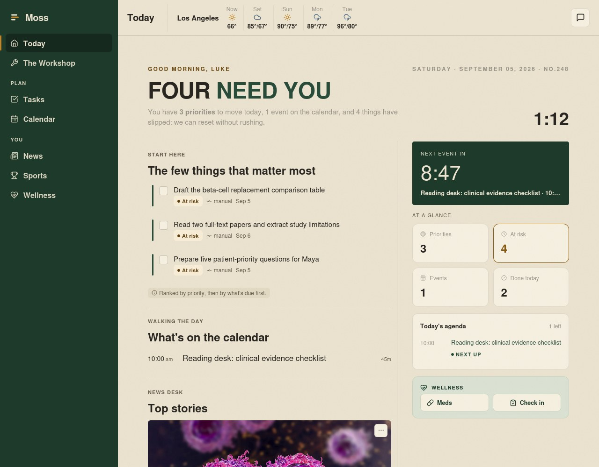

# Moss

Moss is a self-hosted AI assistant. It holds your tasks, notes, calendar and email, and you can ask it to look things up or make changes. Each part also has its own screen.

Moss runs on your own machine with Docker and uses your own Claude, Codex or Gemini sign-in.



## Features

- Chat that can read and change your data
- Tasks, lists, goals, commitments and people
- Markdown and Obsidian notes
- Email and calendar
- Today page with briefings and notifications
- Meeting transcripts and notes
- News, weather and sports
- Wellness check-ins and medications
- Memory across conversations
- Add-on modules such as Finance and Meals
- Workshop, for building your own modules

## Install

Paste this into your AI agent:

```
Please install Moss: https://github.com/motioneso/moss
```

For the manual steps, see the [deployment guide](docs/operations/deploy.md#installation).

## Docs

- [Deployment and configuration](docs/operations/deploy.md)
- [HTTPS setup](docs/operations/self-hosted-tls.md)
- [What's New](docs/WHATS_NEW.md)
- [Module developer guide](docs/module-developer-guide.md)
