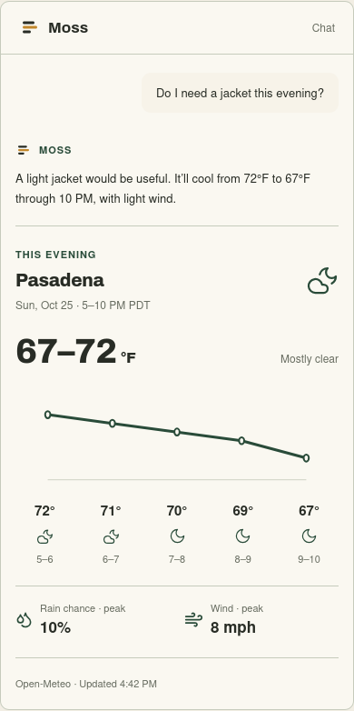
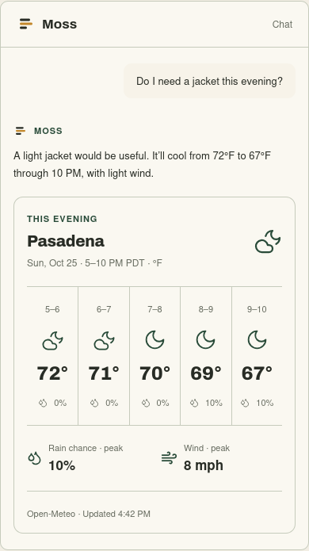
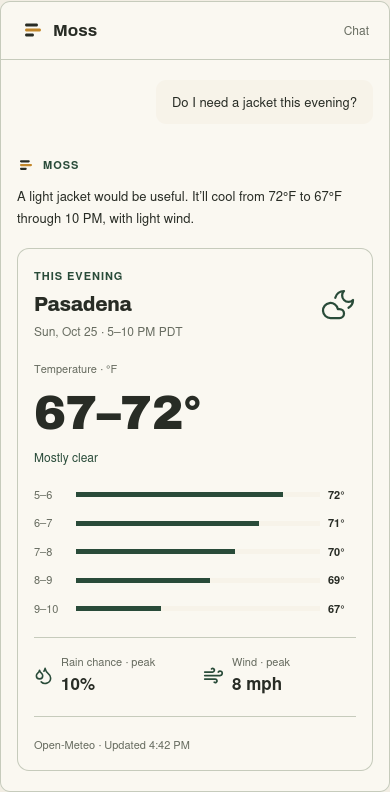

# Weather card studies · #3736

Mockups only. Ben chooses the direction before a separate implementation slice.
The standalone preview is at `apps/web/src/chat/openui-mockup/weather/index.html`,
beside the earlier visual-chat target preview on `prototype/openui-chat-targets`.
There are no product routes, provider requests, saved settings or app-map changes.

| Study                       | Structure                                                         | Trade-off                                                |
| --------------------------- | ----------------------------------------------------------------- | -------------------------------------------------------- |
| A · Evening curve           | Inline temperature trace with aligned hour buckets                | Most immediate sense of cooling; more vertical space     |
| B · Hour by hour            | Contained five-hour strip with weather icons and rain percentages | Best for comparing individual hours; smaller numerals    |
| C · The evening at a glance | Large range beside a small temperature ladder                     | Fastest range scan; individual conditions are summarized |

I recommend A: the falling line makes the evening's cooling visible immediately.
Its inline, ruled layout fits Park Press and leaves the jacket advice in the chat sentence.

All three use authored Moss tokens and `@moss/ui` primitives (`Card`, `Divider`,
`Eyebrow`, `Badge`, `EmptyState`, `Button`, `Select`, `BrandMark`). The chart, strip and ladder
are prototype compositions, not new production primitives. Fonts remain Archivo
and the sans stack; mono, serif, raw colours and decorative source boxes are absent.

## Data and states

All examples are synthetic: Pasadena, Sunday October 25, 5–10 PM PDT. The five
hour buckets run 5–6 through 9–10 PM; the final value is the forecast for that
last bucket, not a fabricated 10 PM observation. Temperatures and prose use the
same whole-degree values. The rain fixture changes both temperatures and weather
conditions. Rain and wind peaks refer to the displayed window.

The partial fixture omits 7–8 PM, marks that interval unavailable and labels
summary values as applying to known hours. The curve breaks across the gap; the
strip and ladder preserve its position without inventing a temperature. The
unavailable fixture replaces all numeric content with the shared empty state.
Every state keeps one short source line. A later build must derive conditions,
rounding, interval labels and summaries from the real snapshot, and preserve
existing approximate-location, stale-data and unknown-metric semantics.

## Preview

From `~/Jarv1s/.claude/worktrees/weather-card-design`:

```bash
pnpm install
weather_card_port=$(devports claim weather-card)
pnpm --filter @moss/web dev --port "$weather_card_port" --strictPort
```

Open `/src/chat/openui-mockup/weather/index.html` on that port. The review controls
select design A/B/C, light/dark/sage, desktop/390px and clear/rain/partial/unavailable.
Selections persist in URL parameters: `design`, `theme`, `view`, `state`.
Stop the server and run `devports release "$weather_card_port"` when finished.

## Review evidence

Cropped chat screenshots are in the preview's `previews/` directory: each design
in light/dark at desktop/390px, plus rainy, missing-hour and fallback phone views.
These are fixture checks, not installed product acceptance.

Validation: web TypeScript, focused ESLint, design-token audit and UI-class audit.
Firefox checked all 48 combinations (three designs × two modes × two widths ×
four states), followed by 12 compact-fallback checks, URL controls, sage mode and a real 390px viewport without page
errors or horizontal overflow. Computed text checks on B's clear, partial and
fallback states in light/dark/sage found a minimum 4.87:1 contrast and no text
below 11px. This bounded contrast probe does not certify arbitrary custom themes.

| A · Curve                                                                                         | B · Hour strip                                                                                    | C · Headline                                                                                      |
| ------------------------------------------------------------------------------------------------- | ------------------------------------------------------------------------------------------------- | ------------------------------------------------------------------------------------------------- |
|  |  |  |
