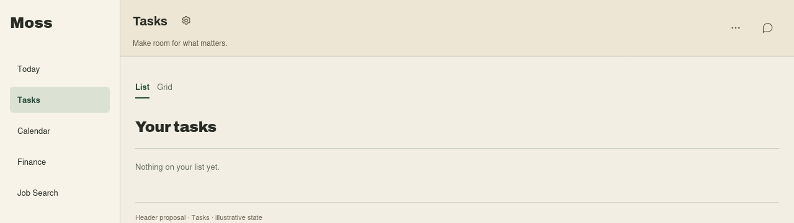
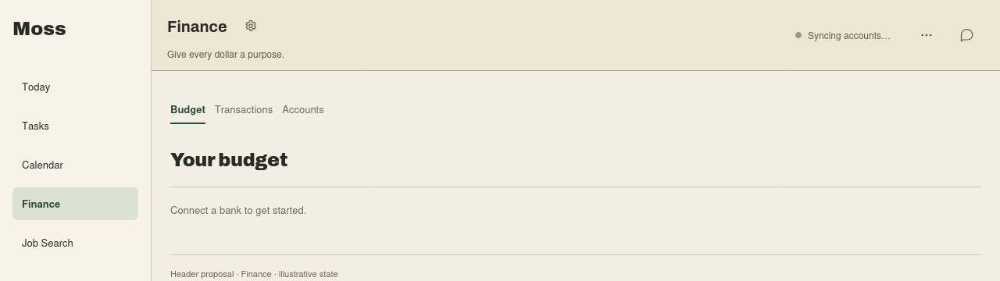
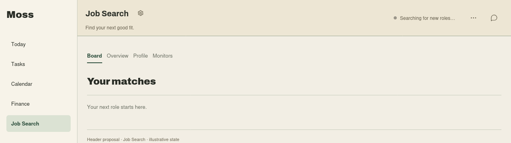
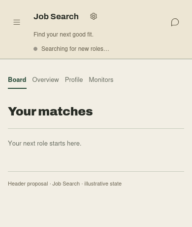

# Shared module header: tagline and live status

Date: 2026-10-21  
Issue: #1343  
Status: **Draft for Ben’s design decision. Spec and static mockups only.**  
Source baseline: `e55248548` on `origin/main`.

## Design decision

Keep the shipped title-adjacent settings cog. Replace the date under module titles
with a short marketing tagline and add one quiet, optional live-status slot between
the title block and shell actions. On phones the status moves below the title block.

Today supplies the visual standard: Archivo headings, paper surfaces, restrained
accent, hairline separation, wide working space and deliberate gaps. This is a
compact shell header, not another hero or a redesign of module content.

The mockups are proposals for approval, not screenshots of shipped behavior.
Illustrative progress and empty states contain no user data. The three tagline
strings below are proposed marketing copy, not existing manifest text.

## What already shipped

The July issue and September audit predate several changes. Checked against the
source baseline above:

| Surface                    | Current source evidence                                                                                                                                                            | Treatment in this spec                                                                                                                   |
| -------------------------- | ---------------------------------------------------------------------------------------------------------------------------------------------------------------------------------- | ---------------------------------------------------------------------------------------------------------------------------------------- |
| Cog beside title           | `apps/web/src/shell/app-shell.tsx`: `TopbarTitles` renders `ModuleSettingsButton` in both ordinary and page-trail title rows                                                       | Preserve its position and ordinary link behavior                                                                                         |
| Settings destination       | `apps/web/src/settings/module-settings-deep-link.ts`: `moduleSettingsHref` uses a module’s `settingsPath`, otherwise `/settings?section=modules&module=<id>`                       | Reuse this resolver; no new settings router                                                                                              |
| Settings availability      | `hasModuleSettings` includes five known built-ins plus runtime `settingsPath` or nonempty `settings`                                                                               | Preserve working behavior; declare missing real surfaces rather than guessing from a module name                                         |
| Subtitle                   | `apps/web/src/app-route-metadata.ts`: built-in routes, generated module routes and runtime external navigation all return the date eyebrow                                         | Module routes need tagline metadata and rendering                                                                                        |
| Context                    | Current `AppShell` has titles and actions; no rendered `topbar-context` slot. Its old CSS remains in `apps/web/src/styles.css`                                                     | Add a bounded status slot; do not assume the July JSX still exists                                                                       |
| Long manifest descriptions | Tasks/Calendar/News navigation descriptions explain detailed behavior; Finance’s package description is technical. `ModuleDto` exposes neither a general description nor a tagline | Do not display app-map documentation as marketing copy                                                                                   |
| Finance                    | `external-modules/finance/jarvis.module.json` declares `settingsPath: "/settings"`; runtime uses the module’s absolute route                                                       | Keep the cog pointing to `/m/finance/settings`                                                                                           |
| Job Search                 | Manifest has navigation but no `settingsPath` or settings surface; `root.tsx` still draws a local Settings link and a queued-search notice                                         | Declare the existing host settings surface, remove duplicate local Settings entry and move truthful search progress into the shared slot |
| Job Search navigation      | Board, Overview, Profile and Monitors replaced the old Board/Settings pair                                                                                                         | Keep these content views; Monitors is source management, not a synonym for module settings                                               |
| Persistent shell controls  | `apps/web/src/shell/module-persistent-controls.tsx` keeps contributed controls mounted through navigation                                                                          | Keep these controls independent of transient module status                                                                               |

The 2026-10-09 ruling supplied in the task brief takes precedence over the July
request to retain multiple settings doors: the header cog is the module’s settings
entry. This spec does not add another text Settings link or redesign settings pages.

## Header layout

Desktop reading order:

```text
[page title  cog]                  [short live status]    [existing shell actions]
[tagline]
```

Phone reading order:

```text
[nav]  [page title  cog]   [chat]
       [tagline]
       [short live status, when present]
```

- The cog remains immediately after the title, with `--space-2` (8px) between them.
  It never moves to a module-specific toolbar or behind an overflow menu.
- The title/tagline block takes the flexible width. Desktop header spans the whole
  workspace; it has no narrow prose measure or centered column.
- Use `--space-5` horizontal and `--space-3` vertical header padding on desktop;
  `--space-3` padding on phones. Status and actions have `--space-6` between blocks
  on desktop. Adjacent controls always have at least `--space-2` in both axes.
- Title remains compact (`--text-xl`, display, bold); tagline uses `--text-xs`,
  sans, sentence case, `--header-muted`, normal tracking. Do not inherit the current
  subtitle’s uppercase date styling. Nothing falls below the 11px floor.
- Title and tagline each occupy one line. Tagline may ellipsize when needed; its
  full text remains in the DOM and is available through a native title tooltip.
  The cog is never shrunk or clipped to make text fit. Long titles ellipsize first.
- At 720px and below, status occupies a separate row aligned with the title block.
  It has at least `--space-3` separation from the block above. No horizontal page
  scroll. The header grows in normal layout; do not overlay status on content.
- A module with no settings has no cog and no empty cog placeholder. With no
  status, render no status row, separator, spinner or “Idle” label. Existing
  actions remain on the far right.
- Expanded chat keeps its current header visibility behavior. With docked chat,
  use the available workspace width and stack status whenever the slots cannot
  fit comfortably, even above the phone breakpoint. Persistent controls take
  precedence over decorative status; never hide a live recording Stop control.
- Audit sticky offsets and viewport-height calculations that use `--topbar-h`.
  The growing header must participate in actual workspace layout; a hardcoded 60px
  subtraction must not hide content or pinned composers.

## Tagline contract

Add an optional module-wide `headerTagline` string to both built-in and installable
manifest contracts and expose it on `ModuleDto` and generated route metadata.
It means a short benefit, not instructions or a second screen title. Proposed
validation: trimmed, plain text, nonempty when supplied, no line breaks, at most
80 Unicode code points. No HTML, Markdown, secrets, counts or changing state.

First-party modules must supply an approved tagline for every module with a page.
Do not shorten or overwrite `navigation.description`, `features` or settings
metadata to achieve this: those descriptions remain useful to Moss’s app map.
A tagline is module-wide even when a module has several navigation entries.

| Mocked module | Proposed tagline             |
| ------------- | ---------------------------- |
| Tasks         | Make room for what matters.  |
| Finance       | Give every dollar a purpose. |
| Job Search    | Find your next good fit.     |

Older third-party modules remain compatible: prefer `headerTagline`, then an
available nonempty package description, then omit the line. Description fallback
is plain text, single-line with visual truncation; never fabricate a generic
“Your module” sentence. Carry the optional description to the shell if needed;
currently it is not in `ModuleDto`. First-party omissions are a build-review
failure, not a reason to display detailed app-map documentation.

Resolve the owning module once for built-in routes, generated routes and runtime
`/m/<id>` routes. More specific routes win over parent prefixes. Subpages and
Workshop page trails retain their existing title/breadcrumb, rename and more-menu
behavior; the tagline belongs to the owning module. A cog’s accessible name uses
the module name, not a project name. Nonmodule pages such as Today, Settings and
Notifications retain their current subtitle. Today’s hero and weather do not move.

## Live-status contract

The shell owns presentation; the active module owns the facts. Use one small,
shared host interface for built-in screens and an equivalent optional capability
in the installable web-surface host bridge. Do not introduce a module-specific
branch in `AppShell`, pass arbitrary JSX into the header, or repurpose persistent
controls as a status bus.

A publication contains a module id, page-lifetime identity, operation identity,
plain-text message and tone (`working`, `success`, `warning`, `error`). The host
binds identity to the mounted module surface. Publication returns an update/clear
handle; a surface may hold one current operation. Newer operations replace older
ones, and an old completion cannot clear or overwrite a newer operation.

- Only the currently viewed module publishes here. Do not show Job Search progress
  over Finance or show a previous user’s status after an account change.
- Clear on page unmount, route/actor change, module disable or removal. Reject late
  updates from a disposed page. Subpages may republish current authoritative state.
  A page crash clears its registration rather than leaving “Working…” forever.
- No new background task runner, polling framework, cross-module activity queue or
  notification history. The operation stays owned by its existing module/service.
- Render plain text, at most 100 Unicode code points, one short sentence. Reject
  multiline/markup payloads. Desktop has a bounded measure; narrower views
  truncate visually while keeping the complete sentence accessible.
- Use quiet text and an optional shared `Indicator`; meaningful state is in the
  words, never conveyed only by colour or animation. No fake percentage/count or
  animation that implies an acknowledged request has actually started running.
- One polite, atomic `role="status"` region; announce changes, not every poll.
  Deduplicate identical messages. Do not announce the initial empty slot.
- Success may clear after five seconds. Error/warning remains while its underlying
  condition persists, until replaced or until the page leaves. Working state ends
  on an authoritative terminal state, not a timer. Failed status reads clear the
  unverifiable “working” claim; local errors retain their recovery path.
- Header status is a summary. Required decisions, Retry controls, validation errors
  and detailed failures stay in their owning content surface; the new slot must
  not hide actionable failures or invent a second settings door.

For Job Search, distinguish **“Search queued…”** from **“Searching for new roles…”**
and **“Search complete”** using real queue/run results. The current queued notice
expires after 12 seconds; that timer is not completion evidence. Reuse the existing
search/poll lifecycle and preserve its bounded expiry handling. On an expired or
failed read, stop claiming progress and explain recovery in the module content.
Remove only the duplicated progress banner after the shared path is integrated.

Finance’s “Syncing accounts…” in the mockup demonstrates the slot. Publishing it
in production requires an existing authoritative sync state; it is not permission
to add a connector or a new sync flow. Tasks demonstrates the normal empty slot.

## Shared primitives and states

The future implementation uses `@moss/ui` `IconButton` styling for shell controls,
the existing `ModuleSettingsButton` link/resolver, and `Indicator` for optional
status marks. Keep links as links. If shared visual treatment is missing, extend
`@moss/ui`; module CSS remains layout only. Use `--header-bg`, `--header-fg`,
`--header-muted`, semantic status colours and `--focus-ring`.

The static HTML loads the checkout’s real tokens, self-hosted Archivo fonts and
shared UI CSS. Mock-local styles describe the proposed shell geometry and context,
not a production component or an approved module-content redesign.

| State                             | Expected treatment                                                                                                     |
| --------------------------------- | ---------------------------------------------------------------------------------------------------------------------- |
| Default / hover / focus / pressed | Existing shared icon-button interaction, visible focus, no title shift                                                 |
| No settings                       | Omit cog, including from keyboard order                                                                                |
| Settings unavailable              | Follow actual settings permission/loading behavior; do not invent a disabled settings link from transient search state |
| Loading                           | Status says what is actually pending; settings stays available                                                         |
| Error                             | Short status summary; actionable recovery in content; settings stays available                                         |
| Success                           | Short confirmation, then quiet slot after five seconds                                                                 |
| Status absent / page empty        | Title, cog if applicable and tagline remain; content owns its empty state                                              |

Settings links have a minimum 44×44px target and an accessible name such as
“Finance settings.” Native Enter activation and modified-click navigation work.
No new dialog or keyboard model is introduced. Inspect the header in light, dark,
Sage and actual custom header colours; status text must use header-appropriate
semantic roles and clear 4.5:1. Error colour alone must never carry meaning.

## Mockups

Open the HTML through a static server rooted at `~/Jarv1s`; font URLs are served
from `apps/web/public/fonts/`. The files load the shared CSS from this checkout.
The phone file uses the same responsive markup, captured at 390px. All frames
show illustrative module context solely to make header placement readable.

| View                         | HTML                                                                    | Screenshot                                                            |
| ---------------------------- | ----------------------------------------------------------------------- | --------------------------------------------------------------------- |
| Tasks, quiet (1280px)        | [tasks.html](2026-10-21-module-header/tasks.html)                       | [tasks.png](2026-10-21-module-header/tasks.png)                       |
| Finance, working (1280px)    | [finance.html](2026-10-21-module-header/finance.html)                   | [finance.png](2026-10-21-module-header/finance.png)                   |
| Job Search, working (1280px) | [job-search.html](2026-10-21-module-header/job-search.html)             | [job-search.png](2026-10-21-module-header/job-search.png)             |
| Job Search, phone (390px)    | [job-search-phone.html](2026-10-21-module-header/job-search-phone.html) | [job-search-phone.png](2026-10-21-module-header/job-search-phone.png) |
| Interaction/status reference | [states.html](2026-10-21-module-header/states.html)                     | [states.png](2026-10-21-module-header/states.png)                     |









## Future build acceptance

1. Ben approves the layout, tagline approach and draft copy before a build starts.
2. Every first-party module page has its approved tagline. Built-in, generated and
   runtime external routes resolve the correct owning module on direct load,
   navigation and nested routes. Old installable manifests still load.
3. Cogs keep their location and existing destinations across subpages. Modules with
   no settings have no cog. Job Search declares its real host settings entry;
   Board/Overview/Profile/Monitors remain. No local duplicate Settings link remains.
4. Status publication/update/clear and queued/running/terminal/error states work
   through real module paths. Navigation, account switch, disable, page crash and
   late completion cannot leave or replace another page’s status. Persistent
   recording controls and Workshop page-trail behavior still work.
5. At 320, 375, 390, 414, 768 and desktop widths, including docked chat and long
   names/taglines, no controls overlap, wrap their labels or lose their targets.
   A taller header does not cover sticky content or break viewport-height layouts.
6. Keyboard, polite announcements, reduced motion, light/dark/Sage and custom
   header colour checks pass. Failed settings/status reads do not claim success.
7. Update core app-map declarations for the header contract and owning manifest
   navigation/settings/features for changed entries, errors and remediations.
   Keep descriptive metadata truthful; no app-map runtime change belongs in this
   docs-only PR. Extend schema, DTO, generated-route and serialization coverage.
8. Run the sanctioned gate procedure and real UI acceptance on the eventual
   product PR. Static screenshots here prove design only.

## Scope boundary and review

No product code, settings-screen redesign, new notification system, new sync job,
module-content redesign or live-data proof is included. The draft PR remains
unmerged pending Ben’s decision. Approval of this document authorizes a later
implementation brief; this session stops after delivering the draft and mockups.
