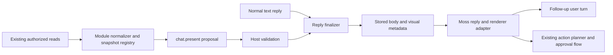

# Visual replies in Moss chat

Status: draft for Ben's review. Ben approved the product direction and requested this
specification on 2026-10-23; production implementation is not yet approved.
Tracking task: [#3583](https://github.com/motioneso/moss/issues/3583).

Moss chooses a useful visual representation when it makes an answer easier to understand
or act on. Asking “How did Liverpool do in their last match?” produces a compact match
result alongside a short answer, without a request for a graphic. Asking a simple factual
question can still produce a sentence.

The first product scope includes eight reply families, a reusable visual vocabulary,
source attribution, conversation-driven controls, and integration with Moss's existing
action flow. A family is available when its module and an authorized data source are
available. Installing this presentation layer does not enable modules, grant access,
subscribe to services, or make unavailable data available.

## Design references and review status

- [Visual target board](visual-chat-replies/targets.html): proposed sports, weather,
  planning, task, money, comparison, recommendation and action-summary compositions.
  The board uses invented examples, supports narrow/wide layouts and light/dark themes,
  and illustrates loading, empty and failure states. Open it directly in a browser;
  fonts and styles are embedded. It performs no app actions.
- [Existing visual and interactive prototypes](https://github.com/motioneso/moss/tree/c9b22e7c8/apps/web/src/chat/openui-mockup):
  Ben positively reviewed the visual direction and live conversation. Inline composition
  is the default; a contained card suits a single result or comparison. The compact
  dashboard remains an upper bound for dense replies, not the everyday default.
- [OpenUI assessment, PR #3580](https://github.com/motioneso/moss/pull/3580).
  The live prototype uses a small native HTML/JSON catalog, not the OpenUI runtime.
  Its successful model calls do not establish production renderer compatibility.

The target board and implementation contracts below are proposals included in this review.
Approval of this spec includes these designs; no new design approval is presumed from
approval of the earlier prototype alone. No new standalone product screen is proposed.

## User experience

A reply normally contains a short answer, one primary visual, relevant sources/freshness,
and up to three useful follow-ups. Use at most three visual sections when the question
needs detail. Do not turn every response into a dashboard, repeat the entire chart in
prose, or make the person choose a visualization before receiving an answer.

Explicit instructions such as “just text”, “give me a table”, “compare these”, or “show
more detail” take precedence over automatic presentation selection. Automatic selection
uses the requested task, available typed data, conversation preferences and supported
catalog. It must not depend on a hand-maintained list of team names or prompt phrases.

Visuals live inside the existing chat thread. They share its identity, spacing, fonts,
source chips, feedback, copy and navigation behavior. Core chat and side chats use the
same rendering path at expanded, drawer and phone widths. Meeting-scoped chat, existing
scheduled task reports and explicitly text-only destinations retain their current text
paths in version 1; they are never reinterpreted as generated UI.

### Built-in reply families

| Family              | Typical request                 | Required content                                                                                         | Useful interaction                                     |
| ------------------- | ------------------------------- | -------------------------------------------------------------------------------------------------------- | ------------------------------------------------------ |
| Sports result       | “Liverpool's last match?”       | Team identities/crests, score, competition, date, status, optional scorers                               | Match details, next fixture, standings                 |
| Weather             | “Will I need a jacket tonight?” | Place, local time window, units, forecast conditions, temperature and supported rain/wind information    | Another time window or place                           |
| Day plan            | “Where can I fit a workout?”    | Time-zone-aware agenda, busy periods and genuinely available gaps; suggested blocks labeled as proposals | Choose a slot, adjust duration, request scheduling     |
| Tasks and reminders | “What needs doing today?”       | Task identity, title, actual due/overdue state, optional priority and completion state                   | View task, request completion, request reminder change |
| Money               | “How is dining out looking?”    | Period, currency, actual/plan/remaining figures and a useful breakdown                                   | Inspect category, explore a hypothetical budget        |
| Comparison          | “Train or driving?”             | Options compared against the same criteria, units and assumptions                                        | Choose a preference, change criteria, ask for details  |
| Recommendations     | “Find something to watch”       | Title, relevant facts, reason for recommendation, verified destination and optional artwork              | Details, refine preferences, open source               |
| Action summary      | “Move that reminder to Friday”  | Host-resolved item, proposed change and actual request/execution status                                  | Existing approval where required, view resulting item  |

All eight are in the release scope, delivered in the stages below. The renderer supports
recommendations from authorized existing reads or user-supplied options; this scope does
not add a streaming-service, travel-booking or other commercial integration. Unavailable
families degrade honestly to text and explain the missing module/source when relevant.

### Liverpool match result

Resolve the intended team using a stable provider/team identity, the user's follows and
conversation context. If Liverpool men's and women's teams remain ambiguous, offer a
small disambiguation choice. Never identify a team from its display abbreviation alone.

“Last match” means the most recent completed fixture across the team's covered competitions,
not simply its last league fixture or a match playing now. Use provider completion state
and kickoff time; exclude upcoming, postponed, cancelled and in-progress matches. Do not
render an abandoned match as a completed result without an official result. Deduplicate
fixtures appearing in multiple reads by stable event identity. Preserve home/away identities
and align each score with its team. Display a draw without inventing a winner; extra-time,
shootout and aggregate scores must remain distinct when supplied.

The primary card shows team crests or accessible initial/name fallbacks, prominent scores,
competition, local date, source status and a short takeaway. Scorers and minute values appear
only when retrieved, grouped with the correct team. Missing scorer detail does not suppress a valid result. A null score is
unknown, never zero. Do not infer possession, expected goals, scorers or other statistics.

Record which competitions and date ranges the lookup actually covered. If a competition
failed or coverage is incomplete, say “Latest available result” with that limitation rather
than claim it is the team's latest match overall. The normal lookup covers a bounded recent
window of 90 days; an explicit older date is a separate bounded read. No result in that window
is a truthful empty state, not permission to show an upcoming fixture as the answer.

Follow-ups resolve the same team and event identity. “Next fixture” and “Standings” make new
authorized reads; unavailable actions are omitted or explained. Opening historical chat does
not fetch current scores. Initial release cards are snapshots, including any explicit live
match answer; continuous live-score polling is outside scope.

### Weather and time-sensitive advice

Use the person's existing location resolution and unit preferences and show the resolved
place. Identify an approximate fallback location and let the person correct it in the
conversation without changing their saved location. Interpret tonight and other relative
windows using the resolved location's time zone; require a time-zone-bearing forecast rather
than infer it from a place label. Forecast times remain labeled on historical cards.

A question about this evening needs interval/hourly data for that window. Current temperature
and a daily low alone cannot support an evening rain prediction. Extend the Weather-owned
public read contract with a bounded forecast window, interval timestamps, temperature,
precipitation probability where supplied, wind and observation/fetch times. If interval data
is unavailable, state that limitation and show the narrower current/daily outlook. Do not
fabricate an hour-by-hour strip or combine unrelated days into one forecast.

### Plans, tasks, money and recommendations

A suggested work block is visually distinct from an actual calendar event. Resolve overlap,
time zones, all-day events and relevant availability from authorized Calendar/Tasks reads;
unknown calendar coverage is not labeled free time. Choosing a slot explores the plan.
Scheduling it is a separate request through the existing action flow.

A task checkbox that changes a real task is an action control, not a local decoration.
Show pending, confirmation if required, success or failure; reconcile the actual task state
and handle revision conflicts. Completing a visual demonstration task never changes a real
task. Reminder summaries use exact resolved timing, repeat terms and destination.

Money calculations use the Finance module's public contracts and deterministic arithmetic.
Keep currency and reporting periods explicit; do not mix currencies or equate “remaining”
with available cash. A what-if slider is labeled hypothetical, uses bounded units and does
not save a budget. When a supported deterministic scenario calculation is unavailable,
show assumptions and estimates as such instead of inventing precise recalculated actuals.

Comparisons show missing criteria as unknown. Recommendation art and destinations must come
from an authorized source/asset descriptor; artwork is optional. Subscription availability,
prices and travel times need sources and dates or an explicit example/assumption label.

## Shared visual vocabulary

Reuse Moss's `@moss/ui` components and semantic tokens. Existing Card, Badge, Note, Button,
AgendaRow and SectionHead are starting points. Add missing general primitives there rather
than styling a second widget system in chat or importing OpenUI's visual kit. Domain cards
remain compositions owned by their modules and exposed through public registrations.

| Primitive          | Contract and behavior                                                                                                       |
| ------------------ | --------------------------------------------------------------------------------------------------------------------------- |
| Metric group       | Up to three labeled values, units, period and optional meaningful comparison                                                |
| Bar or line chart  | Typed series with matching units, explicit axes/baseline and a readable data/table alternative; bar baseline starts at zero |
| Table              | Stable row identity, named columns and an accessible narrow layout                                                          |
| Timeline/agenda    | Ordered entries with time-zone context and actual/proposed distinction                                                      |
| Detail/option card | Compact identity, relevant facts, optional controlled artwork and source                                                    |
| Choice group       | Labeled choices with a clear selected state and a specific follow-up                                                        |
| Numeric slider     | Named quantity, bounded min/max/step, units, keyboard input and explicit Apply                                              |
| Source and status  | Reuse existing provenance/freshness; factual status is host/source derived                                                  |

Support one level of composition, not arbitrary page layouts. Proposed version-1 limits are
three sections, three metrics, two chart series of at most 24 points, ten comparison/table
rows, twelve timeline/task rows, six recommendation/choice cards, depth four, 80 component
nodes, and 64 KiB for the serialized visual envelope. Enforce limits before persistence and
rendering. Summarize excess data with a supported follow-up; do not silently truncate a total
or show a misleading partial chart. These are application limits, not claims about OpenUI.

## Presentation and data contracts

### Generation and ownership

Use a host-owned, versioned presentation contract independent of the renderer. The proposed
production adapter uses `@openuidev/react-lang` with a curated Moss library for generic
compositions. Fixed domain cards render ordinary Moss React components through the same
catalog boundary. Do not adopt OpenUI's chat shell, hosted gateway, cloud telemetry or built-in
tool/query/mutation components.

Before adoption, pin a published renderer version and verify the runtime gate below. The
assessment's 1.0.1 release is an evaluation candidate, not permission to track upstream main.
If the gate fails, stop that implementation slice with a measured recommendation; do not
silently replace the renderer or mark the agreed integration complete. Plain text continues
to work while this decision is resolved.

Provide a read-only `chat.present` tool through Moss's existing tool registry. It selects an
allowed template/composition and references data obtained in the current authorized turn;
it does not fetch data, write app state or create authorization. Use existing configured
chat engines and model routes. Do not hardcode a provider/model, request a new paid service,
or run a second generation pass just to decorate a sentence.

The module-owned read adapter registers a bounded, typed snapshot and an opaque reference
with the turn's presentation registry. It marks source identity, retrieval time, covered
scope and relevant provenance. Only data authorized for this actor and conversation may be
registered. User-pasted/example data has a separate “Your data”/“Example” origin. Source facts
remain untrusted content and preserve existing outside-content tracking.

`chat.present` proposes template identity, snapshot references and, for a generic composition,
a restricted OpenUI program. Components bind to snapshot references/fields rather than accept
model-authored scores, transaction amounts or arbitrary remote image URLs. Derived numbers
come from allowed host/module calculations with declared inputs. The model can write concise
interpretation and labels, but cannot promote its own numbers to source-backed facts.

The validator resolves references, checks the registered type/field compatibility, source
scope, catalog names, argument schemas and resource limits, and rejects unsupported runtime
features before accepting a proposal. Do not rely on prompt restrictions or permissive
renderer parsing for this boundary. An invalid proposal falls back to useful prose without
an automatic model retry. No raw DSL is displayed as the ordinary answer.

The active module registry supplies template registrations and public normalizers. Core chat
must not import Sports/Finance internals, query their tables or add module-name branches in
`RecordRow`. Version 1 admits the reviewed built-in catalog only; a third-party template or
script/plugin installation system is outside scope.

### Stored and streamed reply

Keep ordinary prose in `ChatMessageDto.body` and `TranscriptRecord.text`. Add the same optional
`visualReply` envelope to history and live contracts, with explicit schema validation and
serialization. Proposed fields are `version`, `catalogVersion`, `blocks`, `snapshots` and
`fallbackText`. Each block has a stable `blockId`, registered template kind and snapshot refs;
a composition also has its validated program. A snapshot carries only display-required typed
data, origin, source/provenance refs, retrieval time, coverage and any relevant entity revision.

Store the accepted envelope under versioned assistant-message metadata, committed with the
final reply, not in a separate unscoped browser cache. Keep source IDs and citations connected
to the existing answer-provenance and freshness contracts. `fallbackText` is a host-formatted
readable representation of the visual's essential facts; it supplements the prose without
requiring raw DSL. The envelope must not store connector credentials, full provider payloads,
server-only approval previews or an execution grant.

Version 1 streams prose normally and shows a small preparing-visual placeholder only after a
valid presentation is proposed. Publish the complete validated visual with the final reply;
do not expose partial controls while a program is incomplete. Persist before acknowledging
completion. Live, history and reconnect rendering must converge on the same message/turn ID;
late visual output cannot attach to another reply or create a duplicate message.

On cancellation or model failure, retain whatever the current chat contract retains of the
text, remove uncommitted visual placeholders and never activate controls. Do not invent a
completed visual after a cancelled turn. Older messages without visual metadata render exactly
as before. Unknown envelope/catalog versions, malformed/truncated programs, renderer exceptions
or unsupported engines show useful prose plus the readable fallback. Visual errors never hide
the surrounding answer, approvals, source chips or composer.

Snapshots are immutable historical evidence. Reopening a thread does not refetch, rerun a model
or execute controls. A requested update creates a new read and reply with a new timestamp.
Source deletion, revoked access, module disablement and reduced consent must be evaluated under
the existing chat/history policy; do not bypass it to hydrate missing details. If required
references are unavailable, keep the permitted fallback and mark the visual unavailable.

Keep message retention/deletion/export and incognito behavior authoritative for visual metadata.
Do not create a new durable store outside those lifecycles. Exports and copy include prose plus
an accessible text/table representation and sources, never raw DSL by default. Stored choices
are ordinary follow-up user messages; unsent slider drafts are local and reset on reload.

## Interaction and action behavior

Allow three host-dispatched interaction kinds: a conversational follow-up, a supported app
navigation target, or a request for an existing app action. Resolve their destinations from
registered descriptors and the current actor/thread, not model-supplied URLs, HTTP verbs or
paths. Each descriptor binds the message/block, relevant snapshot/entity revision and bounded
selection parameters. OpenUI custom events are proposals to this dispatcher, never authority.

A choice or Apply click sends a visible user follow-up carrying the selected value and
referenced example/entity. Reuse normal conversation context and busy/admission behavior.
Changing a slider alone sends nothing. Only explicit Apply submits; values are validated on
the server. Do not silently discard a busy user's selection or send it to a newly selected
thread. Preserve the draft with a clear retry/stop path. Block double submission and correlate
retries through a host-generated interaction ID at the turn-admission boundary.

A real write uses the existing action resolver, permissions, module state, consent, outside-
content rules, approval requirements, validation and writer. Re-resolve the target and its
revision before execution. Show the existing ActionRequestCard/WorkflowApprovalCard where
policy requires it. A visual selection neither approves a later write nor removes an approval
requirement. Preserve the writer's existing replay guarantees; do not claim exactly-once
external effects. No side effect runs on render, reload, state hydration or component mount.

Action summaries reflect host-authored request/execution events. “Proposed”, “Awaiting approval”,
“Working”, “Completed”, “Denied”, “Cancelled”, “Failed” and “Needs a fresh request” are distinct.
Only actual successful execution permits Completed; a model saying “done” does not. The summary
references the existing request/result instead of creating a second approval mechanism or
persisting live-only sensitive previews. If the saved action outcome lacks summary details,
history shows its status and request reference rather than reconstructing the live preview.
Restored/expired controls cannot silently retarget
another resource. On conflicts, explain the change and request a fresh review through the
normal flow. Invalidate affected app views only from actual successful action events.

## Presentation, accessibility and failure states

Use the authored Moss typography and tokens, including every supported theme, focus state and
minimum text size. New primitive code belongs in `packages/ui`; module CSS stays layout only.
Avoid raw chart colors and meaning conveyed by color alone. Crests, artwork and small icons
never replace readable names. Use branded fallback marks when approved assets are unavailable.

At 390px and the 404px drawer, stack metrics/options as needed, wrap long titles, preserve
legible touch targets and avoid page-level horizontal scroll. Tables use a deliberate stacked
or contained-scroll presentation without losing column meaning. Charts have accessible names
and equivalent text/table values. All choices, slider controls, follow-ups and approval links
work by keyboard, have associated labels and preserve focus. Respect reduced motion; announce
reply/control status without reading an entire chart on every slider movement. Show visual
state without moving the reader away from their current scroll position.

| State                             | Required behavior                                                             |
| --------------------------------- | ----------------------------------------------------------------------------- |
| Loading                           | Brief progress in the reply; keep readable prose and composer usable          |
| Empty                             | State the precise missing coverage/result, with an appropriate follow-up      |
| Partial                           | Render supported fields and name the important missing coverage               |
| Stale                             | Show snapshot/update time and existing freshness warning; update is explicit  |
| Read denied or consent off        | Explain the existing access requirement without exposing hidden data          |
| Read failed                       | Keep available text/data, offer a bounded explicit retry through normal reads |
| Invalid visual or renderer failed | Show readable fallback; no DSL, broken card or automatic write                |
| Interaction failed or conflicted  | Keep selection/message, state failure, retry or request fresh action          |

Remote images and links must obey the relevant host/module asset policies and current
meeting-scoped restrictions. Resolve artwork/crests from reviewed asset descriptors and reject
executable schemes, arbitrary HTML/CSS/JavaScript, unsafe resource references and runtime
Query/Mutation/tool providers. Measure and inspect actual renderer/network behavior before
asserting isolation: the assessed development entry can load CDN devtools. Production and
development integration must disable or remove unapproved loader behavior and prove the
result with observed requests. Do not promise network isolation from the package name alone.

## Current integration points and required gaps

Source baseline: `021fd9a0c` on main. Paths below were checked for this specification.

> 🧠 **From Hindsight memory (Moss acts through the app (issue 3065))** — Moss's app-action design uses the app's own API, server-resolved approval details and outside-content tracking. The current resolver and reply components were checked before carrying that boundary into this proposal; current policy remains authoritative.

| Current seam                                                             | Required work                                                                                                                                  |
| ------------------------------------------------------------------------ | ---------------------------------------------------------------------------------------------------------------------------------------------- |
| `packages/shared/src/chat-api.ts`: `ChatMessageDto`, `TranscriptRecord`  | Optional versioned visual envelope shared by live and history; update their actual schemas                                                     |
| `packages/chat/src/route-serializers.ts`: `serializeMessage`             | Explicitly read/validate/serialize new metadata; unknown fields currently do not round-trip                                                    |
| `packages/chat/src/live` and `apps/web/src/chat`                         | Finalization, stream reduction, reconnect and record identity; integrate every supported engine without altering text-only paths               |
| `apps/web/src/chat/message-row.tsx`, `markdown-message.tsx`              | Add a separate bounded visual slot; retain Markdown, provenance, freshness, feedback, scheduled-report handling and meeting image restrictions |
| `packages/chat/src/app-actions.ts` and `app-action-validation.ts`        | Reuse current resolver/validator/approval flow for action requests; do not replace it                                                          |
| `packages/sports/src/manifest.ts`, `packages/shared/src/sports-api.ts`   | Overview is chat-blocked for effects; add a module-owned read-only latest-result/details path with stable identities, coverage and provenance  |
| `packages/weather/src/manifest.ts`, `packages/shared/src/weather-api.ts` | Current/daily forecast read exists; add interval data and time-zone/freshness coverage needed for tonight/hourly advice                        |
| `packages/module-registry`, `packages/module-sdk`, `packages/ui`         | Declared built-in registrations, shared primitives and renderer boundary; no cross-module internal imports                                     |
| `packages/shared/src/app-map-core.ts`, owning manifests                  | Declare visual chat behavior and each enabled family's requirements, controls, errors and remediations in the same implementation PR           |

The sports read must not enable the existing side-effecting overview route or perform follow,
source-sync, source-authority or settings writes. Use existing reviewed outbound fetch/cache
machinery and policies; a renderer must never become a provider proxy. Match lookup and Weather
extension are part of the required data work, not assumed existing capabilities.

## Delivery stages and approval boundary

This is a product/design specification, not an executable multi-agent build plan. Implementing
a stage requires this spec's approval and a task-linked implementation plan. Stages may land
incrementally, but the full catalog is not complete until the final acceptance set passes.

1. **Runtime and contract gate.** Pin/evaluate the renderer with Moss's actual React/Zod/build
   setup and configured chat engines. Validate a limited catalog, rejected constructs, error
   handling, bundle loading and development/production network requests. Prove one typed
   snapshot through `chat.present`, final reply, streaming, history, reconnect and copy.
   Exercise 20 fixed examples on each engine/provider configuration used for rollout: at
   least 19 render the intended visual on the first attempt; all 20 retain useful text and
   no case crosses the action/data boundary. Record prompt/output overhead, model latency
   and incremental bundle size; no numeric savings claim is accepted without measurement.
2. **Read-only domain pilot.** Deliver sports and Weather reads/cards plus the existing planning,
   money and comparison targets with authorized data. Include task display and recommendation
   display as their authorized sources become available. No write controls at this stage.
   “Latest Liverpool match” and evening-weather advice are required live pilot cases.
3. **Conversation controls.** Enable choices, bounded scenario sliders, follow-ups and supported
   navigation. Verify context, unsent drafts, retry/deduplication and historical behavior.
4. **Action integration and complete catalog.** Add real task/reminder controls and host-owned
   action summaries through existing action requests. Complete all eight families, all
   supported themes/surfaces, text-only destinations and map declarations before announcing
   out-of-the-box support. No new visual reply settings screen is proposed; unavailable
   engines/sources fall back to text. Any rollout switch must have safe missing-value defaults
   and ship in every affected deployment configuration in the same PR.

## Acceptance and evidence

Implementation tests follow the repository's meaningful unit/contract/integration/browser
conventions. Database-touching commands require the verify-gate workflow. The docs-only PR
runs document/link/privacy checks; it does not claim product tests or production integration.

| Case                      | Observable acceptance                                                                                                                                                                                                      |
| ------------------------- | -------------------------------------------------------------------------------------------------------------------------------------------------------------------------------------------------------------------------- |
| Liverpool last match      | Latest completed fixture across covered competitions; correct team/score alignment, competition/date/status, sources, no explicit request for a graphic                                                                    |
| Sports ambiguity and gaps | Men's/women's ambiguity resolved; missing scorers omitted; null scores stay unknown; failed competition changes “latest” claim; no-result and shootout/draw cases are correct                                              |
| Evening weather           | Correct place/units/time zone and requested hourly window; missing hourly data cannot produce a rain window; correcting a place does not save preferences                                                                  |
| Agenda and tasks          | Proposed vs actual blocks clear; genuine busy periods honored; overdue/completed state matches source; real completion follows normal action policy                                                                        |
| Money and comparison      | Sourced arithmetic/period/currency correct; unknown criteria explicit; slider Apply creates a new contextual reply with the selected amount and no budget write                                                            |
| Recommendation            | Source-backed facts/destination, optional artwork fallback, no fabricated subscription availability                                                                                                                        |
| Action summary            | Real pending/success/denial/failure/conflict states; no success from prose; repeat click/reload cannot replay a write; revoked permission blocks the request                                                               |
| Lifecycle                 | Refresh, reconnect, late/out-of-order events, side-chat switching, cancellation, deletion, export and incognito match the current host lifecycle; no cross-thread attachment                                               |
| Failure and compatibility | Unknown version/component, invalid/oversized program, engine refusal and renderer exception preserve text/fallback; old messages unchanged; text-only destinations remain text                                             |
| Provenance and privacy    | Fields map to the right snapshot/source and retrieval time; other actors' data and raw connector/approval secrets never enter visual metadata or fallback                                                                  |
| Presentation and access   | Expanded, 404px drawer and 390px phone; light/dark/sage plus shipped custom themes, keyboard, touch, screen-reader equivalents, 200% zoom and reduced motion                                                               |
| Boundaries                | Adversarial programs/events cannot call tools, invent trusted source refs, choose arbitrary routes/assets, or create side effects during render/reload; verify rejection with the guard removed where the repo requires it |
| App map                   | Core and owning-module feature declarations accurately describe availability, controls, missing data and remediation                                                                                                       |

Record real installed-dev browser evidence on each user-facing implementation PR: the prompt,
read/source path, rendered result and interaction outcome. Fixtures and the synthetic target
board establish design behavior; they do not prove the real data path. Keep the rollout status
in the tracking issue and record any unmet acceptance case before declaring a stage complete.

## Scope exclusions

No arbitrary generated websites or scripts, module installation, new commercial connectors,
continuous live-score polling, maps, custom dashboards saved outside chat, multi-step forms,
automatic historical refetch, broad approval-policy changes, or production use of the local
prototype's Codex login/HTTP bridge. Existing public module/data/action boundaries remain the
integration surface. A proposal to add one of these is a separate scope decision.
